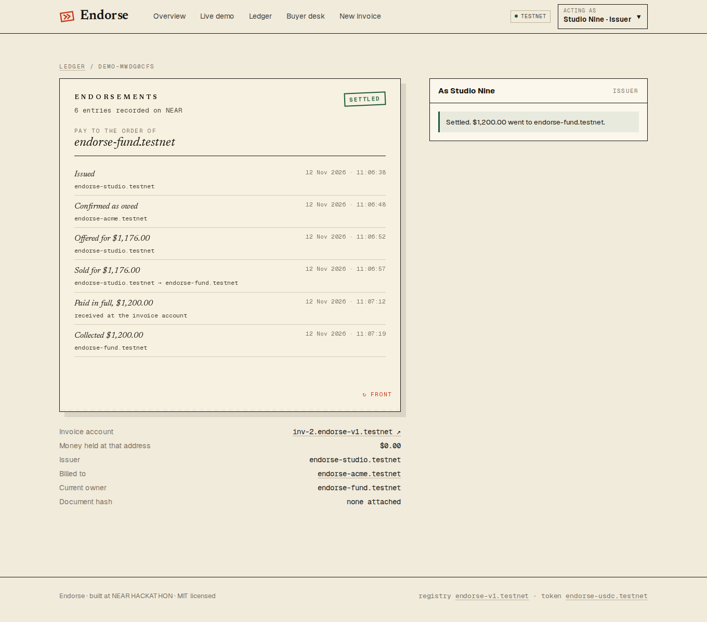
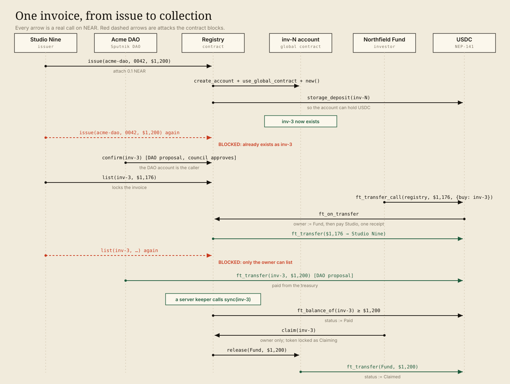
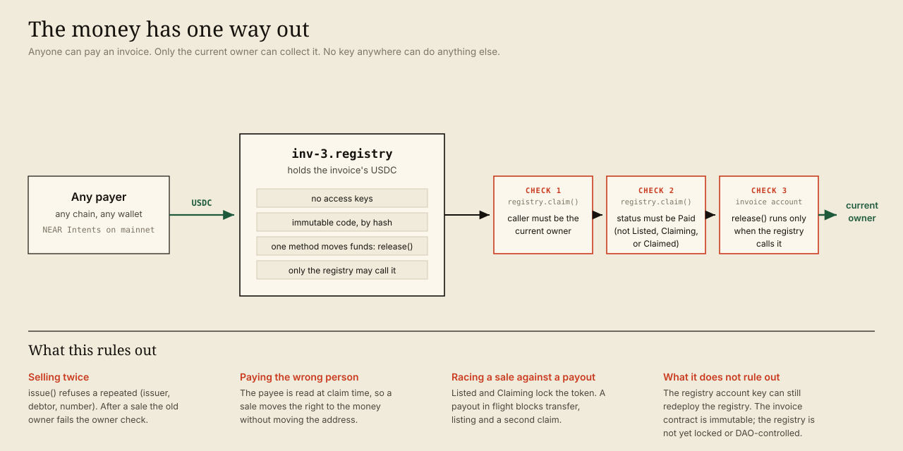
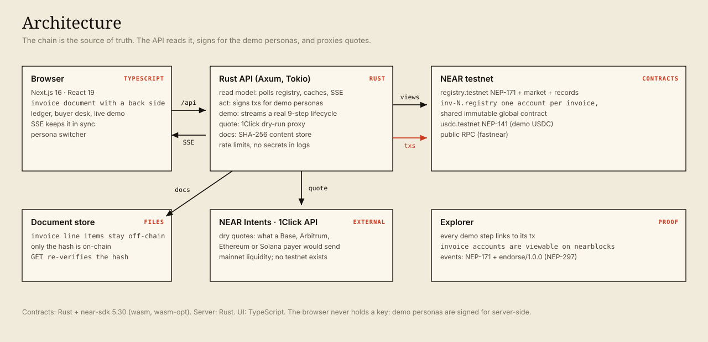

# That Invoice

[](https://github.com/PhiBao/that-invoice/actions/workflows/ci.yml)

**The invoice is the account.**

That Invoice gives every invoice its own NEAR account. The business can sell the invoice for cash today, and whoever owns it when it is paid collects. The client keeps paying the same address, so nothing has to be forwarded and nothing can be sold twice.

Built for **NEAR HACKATHON 2026**. Primary track: **NFTs That Do Something** (`nfts`). Also fits **Real-World Money** (`realworld`), **Unstoppable DeFi** (`defi`) and **Social Money** (`social`).

> Everything runs on **NEAR testnet**. Invoices settle in a **demo USDC** token. Cross-chain payment is shown as live dry-run quotes from NEAR Intents (Intents has no testnet). See [What is real, what is not](#what-is-real-what-is-not).

**Live demo:** https://thatinvoice.uconfidant.tech · **Repo:** https://github.com/PhiBao/that-invoice

> The demo server sleeps when idle to save cost. The first visit can take about 6 seconds to wake it; the page shows a "waking the demo server" banner meanwhile.



---

## Try it

Three paths, from least to most effort. None needs a wallet extension or any NEAR of your own.

### 1. Watch the whole lifecycle (about a minute)

1. Open **https://thatinvoice.uconfidant.tech/demo** and press **Watch it run, live**.
2. **Expected:** ten steps, each with a transaction link. Eight pass and two are stamped **BLOCKED**: the same invoice issued twice, and the old owner trying to sell again. Those are attacks the contract must refuse, and the contract's own error text is shown.
3. Steps 3 and 7 are done by a real **Sputnik DAO** (Acme DAO). Each shows a *proposal* link and an *approval* link: a proposer files it, a separate council member approves it, and the DAO itself then calls the registry.
4. Step 8 says *"recorded automatically"*: a server-side keeper noticed the payment and told the registry. Nobody pressed a button.
5. Click **Open the invoice**, then **Endorsements ↻**. **Expected:** the back of the invoice lists Issued, Confirmed as owed, Offered, Sold, Paid in full, Collected, ending with `Pay to the order of endorse-fund.testnet`.

### 2. Do it yourself with your own account (about a minute)

1. Open the **Buyer desk**. **Expected:** several confirmed invoices for sale, some from different issuers and clients, one possibly past due and marked *distressed*. Each shows the client's payment record.
2. In the header choose **Acting as → Use your own account**. **Expected:** after about 10 seconds a real NEAR testnet account exists in your browser, holding demo USDC. You sign with your own key; the server never sees it.
3. Press **Buy** on an invoice. **Expected:** a toast says it was *signed by your account*, with a transaction link. Open the invoice: *Pay to the order of* now shows **You**.
4. On the invoice page press **Make the client pay now** (a labelled demo helper). **Expected:** the Acme DAO pays by proposal, the server records the payment, and a **Claim** button appears.
5. Press **Claim**. **Expected:** *Settled*, and the amount lands in your own account.

### 3. Verify the claims yourself

```bash
node scripts/verify-deployment.mjs     # reads public chain data, no keys needed
```

It checks that the invoice contract is an immutable global contract, that invoice accounts hold no keys, and that the registry's access keys are gone. Every demo step also links to its transaction on the explorer, and each invoice's NFT renders as the stamped invoice in any NEAR explorer (see [Dynamic NFTs](#dynamic-nfts)).

Prefer a terminal? `node scripts/e2e.mjs` runs a lifecycle with real transactions and prints each step.

The demo run belongs to the server, not your browser tab. If your connection drops, the page reconnects and replays the steps so far, and a second visitor watches the same run.

---

## The problem

A freelancer, studio or agency that bills crypto-native clients (DAOs, protocols, web3 companies) usually waits 30 to 60 days to be paid. The ways to get cash sooner are poor:

- **Factoring** costs 1 to 5 percent a month, takes days to onboard, and needs the client to be notified.
- **Receivables pools** on-chain (Centrifuge, Huma) still send the client's payment to the original business, which then has to forward it to the investor.
- **Investors fear double-financed invoices.** First Brands had about $2.3B of factoring liabilities while investigators asked whether invoices had been sold more than once ([Reuters](https://www.investing.com/news/stock-market-news/first-brands-creditor-says-23-billion-simply-vanished-seeksprobe-4278590), [GTR](https://www.gtreview.com/news/americas/first-brands-faces-investigation-into-double-financing-of-receivables-inventory/)). The UCC registry records a pledge, but it does not identify individual invoices ([IFA Commercial Factor](https://magazine.factoring.org/magazine-articles/rethinking-receivables-risk-what-recent-frauds-reveal-about-market-infrastructure)).

## The idea

**Make the thing being paid the thing being sold.**

When the payment address *is* the asset, a sale needs no notice to the client and no forwarding step. Whoever owns the invoice token when the payment arrives can collect it. Two sellers cannot both own it, and the old owner cannot redirect the money.

| | Factoring / pools | That Invoice |
|---|---|---|
| Who the client pays | The original business | The invoice account itself |
| After a sale | Business forwards the money | Nothing to forward; the buyer collects |
| Same invoice sold twice | Possible, found later | Refused by the contract |
| Client notified of a sale | Usually yes | Not needed |
| Pay from another chain | No | Yes, through NEAR Intents |

## How it works



1. **Issue.** `registry.issue(debtor, number, amount, due, doc_hash)` creates `inv-N.<registry>` as a real NEAR account running one shared, immutable contract, registers it on the USDC token, and mints the invoice as an NEP-171 token to the issuer. The pair (issuer, debtor, number) is unique.
2. **Confirm.** Only the debtor account can confirm. The debtor can be a person or a DAO: in the demo it is a real [Sputnik DAO](https://github.com/near-daos/sputnik-dao-contract) that confirms through a proposal a council member approves. Only confirmed invoices can be sold.
3. **Sell.** The owner lists at a discount. A buyer calls `ft_transfer_call(registry, price, {"buy": id})`. In a single receipt the token moves to the buyer and the seller is paid. Listing locks the token.
4. **Pay.** The client sends USDC to `inv-N.<registry>`. In the demo the DAO pays from its treasury, also by proposal. On mainnet, NEAR Intents can route USDC from Base, Arbitrum, Ethereum or Solana into the account (shown as live quotes).
5. **Record and collect.** `sync` reads the invoice account's token balance. When it covers the face value the invoice is `Paid`. A server-side keeper calls `sync` as soon as it sees the money (anyone may call it; the keeper has no special power). The current owner calls `claim`; the registry asks the invoice account to release the money to that owner. The token is locked (`Claiming`) until the payout settles. If more money arrives after collection, `sync` reopens the invoice for whoever owns it at that moment.

### Dynamic NFTs

Each invoice is an NEP-171 token whose `nft_token` returns NEP-177 metadata with a `media` field: an SVG generated by the contract from the invoice's current state. The stamp on it changes as the invoice moves through *Issued, Confirmed, For sale, Overdue, Paid, Settled*, so a wallet or explorer shows the live document, and nobody has to update any metadata.

```bash
near view <registry> nft_token '{"token_id":"inv-3.<registry>"}'
```

### Why the money cannot go to the wrong person



The invoice account has one exit, `release()`, callable only by the registry. The registry calls it only from `claim`, which only the current owner can call, and only while the invoice is `Paid`. The invoice contract is published as a [NEP-591 global contract by code hash](https://docs.near.org/smart-contracts/global-contracts), so it is immutable and has no keys. The registry's own access keys have been deleted, so its rules cannot change either; `scripts/verify-deployment.mjs` checks both from public chain data.

### Client record

The registry keeps a record per debtor: invoices confirmed, paid, paid on time, total paid, and days late. Only confirmed and paid invoices count, so nobody can damage an account's record by billing it. The Buyer desk shows this record next to each price, which is the information an investor needs.

---

## What is real, what is not

| Part | Status |
|---|---|
| Registry and invoice-account contracts | **Real.** Deployed on NEAR testnet; source in `contracts/`. |
| Invoice accounts (`inv-N.<registry>`) | **Real** NEAR accounts created on issue, running the shared global contract. |
| Issue, confirm, sell, pay, claim | **Real** transactions, each linked in the UI. |
| Acme DAO | **Real** Sputnik DAO on testnet. Confirming and paying are real proposals approved by a separate council account. |
| Refusals (duplicate issue, resale by the old owner) | **Real** contract panics, shown verbatim. |
| NFT art | **Real**, generated on-chain by the contract at view time. |
| Debtor record | **Real**, computed on-chain. |
| Payment detection | **Real**: a keeper polls invoice accounts and calls `registry.sync`. |
| Guest account | **Real** NEAR testnet account (implicit account) whose key is generated and kept in your browser. You sign your own transactions. |
| USDC | **Demo token** on testnet (the shared global NEP-141, 6 decimals). Worthless. |
| Cross-chain payment | **Live dry-run quotes** from the NEAR Intents 1Click API against mainnet liquidity. No funds move. Intents has no testnet, so the demo invoices are paid in test USDC. A mainnet payment is on the [roadmap](#limitations-and-roadmap). |
| Server personas (Studio Nine, Northfield Fund, the DAO's proposer and council) | **Server-held testnet keys**, so the demo runs without a wallet. They hold test funds only. |
| The market | **Seeded and self-restocking.** Kestrel Audit, Loom Labs, Studio Nine and the clients are demo accounts. A background market maker issues, confirms and lists invoices so the Buyer desk is never empty. They are normal invoices anyone can buy. |
| "Make the client pay now" | **Demo helper.** In real life the client pays on its own schedule. |
| Wallet extension login (HOT, Meteor, etc.) | **Not built.** Guest accounts cover the same need for a demo. |

## Architecture



| Layer | Tech | Notes |
|---|---|---|
| Contracts | Rust, `near-sdk` 5.30, wasm + `wasm-opt` | `registry` (about 265 KB) and `invoice-account` (about 110 KB). 58 unit tests. |
| API | Rust, Axum, Tokio, `near-api` | Polls the registry into a cached read model with SSE; signs for personas and files and approves DAO proposals; runs the guided demo as a server-side job (a dropped browser reattaches and replays it); a keeper records payments; a market maker keeps the Buyer desk stocked; funds guest accounts; fails over between public RPCs; proxies 1Click dry quotes; stores invoice documents by SHA-256. |
| Web | Next.js 16, React 19, TypeScript, pnpm | Hand-written CSS (no component library). Newsreader, Geist, Geist Mono. |
| Chain access | NEAR public RPC (fastnear) | |

### Repository layout

```
contracts/registry          invoice state machine, NEP-171, market, client records (+ tests)
contracts/invoice-account   the tiny contract every invoice account runs
services/api                Rust API
apps/web                    Next.js app
scripts/                    build, deploy, bootstrap, e2e, diagram generator
docs/diagrams               the three SVG diagrams (generated by scripts/gen-diagrams.py)
docs/SUBMISSION.md          hackathon submission kit (drafts)
Dockerfile, fly.toml        one image with API + web; Fly.io config (scales to zero)
deploy/entrypoint.sh        starts the API, waits until it answers, then opens the public port
deployment.json             what is deployed on testnet
```

### Deployed on testnet

| Item | Value |
|---|---|
| Registry | `endorse-v1.testnet` |
| Demo USDC | `endorse-usdc.testnet` |
| Invoice contract (global, by hash) | `EGwUfUK3o1Uqp7QWC4pXenmz89idUbsnZLQj7XHXh9BV`, published by `endorse-pub2.testnet` |
| Acme DAO (Sputnik) | `thatinvoice-acme.sputnikv2.testnet`; proposer `endorse-acme.testnet`, council `council.endorse-fund.testnet` |
| Personas | `endorse-studio.testnet`, `endorse-fund.testnet` |
| Seed issuers and client | `kestrel.…`, `loomlabs.…`, `northwind.endorse-studio.testnet` |

The `endorse-*` account names come from the project's working title. NEAR accounts cannot be renamed, so the testnet deployment keeps them.

---

## Run it

**Prerequisites:** Rust (stable or nightly) with the `wasm32-unknown-unknown` target, Node 22+, pnpm 11, and [`binaryen`](https://github.com/WebAssembly/binaryen) for `wasm-opt` (optional; only for size).

```bash
git clone <this repository> && cd that-invoice
pnpm install
```

### Option A: use the existing testnet deployment

You need the persona keys in `~/.near-credentials/testnet/` (the repo does not contain keys), or your own deployment (Option B).

```bash
cp .env.example .env                       # points at endorse-v1.testnet
set -a; . ./.env; set +a
cargo run -p that-invoice-api --release         # API on :8787
pnpm --dir apps/web build && pnpm --dir apps/web start    # web on :3000 (API_URL defaults to http://localhost:8787)
```

### Option B: your own deployment in about a minute

This creates new accounts, deploys your own registry against the already-published invoice contract, funds three personas, and writes `.env`.

```bash
node scripts/build-contracts.mjs                     # builds target/wasm/*.wasm
FUNDER=you.testnet node scripts/bootstrap.mjs        # sub-accounts of a funded testnet account (about 8 NEAR)
# or, without a funded account (the public faucet is rate limited):
node scripts/bootstrap.mjs
set -a; . ./.env; set +a
cargo run -p that-invoice-api --release
pnpm --dir apps/web build && pnpm --dir apps/web start
```

### Deploying to Fly.io

The repo ships a `Dockerfile` (Rust API plus Next.js in one image) and a `fly.toml` that scales to zero.

```bash
fly apps create <name> && fly volumes create that_invoice_data --size 1
fly secrets set NEAR_KEYS='{"<persona>.testnet":"ed25519:...", "<token-account>.testnet":"ed25519:..."}'
fly deploy
```

The container starts the API first and opens the public port only once the API answers `/healthz`, so a woken machine never serves a half-started app.

### The Acme DAO and the seeded market (optional)

Without these, the demo falls back to a plain Acme account that confirms and pays directly.

```bash
node scripts/setup-dao.mjs       # creates a Sputnik DAO (needs ~7 NEAR) with a separate council account
node scripts/seed-market.mjs     # issues, confirms and lists a small portfolio
ACME_DAO=<your dao account> ...  # then start the API with the DAO configured (see .env.example)
```

### Tests and checks

```bash
cargo test --workspace                 # 60 tests: the contracts' state machine, locks, sale and claim races, top-ups, NFT art, and the API's account derivation
pnpm --dir apps/web typecheck
REGISTRY_ACCOUNT=endorse-v1.testnet node scripts/e2e.mjs   # full lifecycle on testnet, real transactions
```

### Environment variables

See [`.env.example`](.env.example). The important ones: `REGISTRY_ACCOUNT`, `USDC_ACCOUNT`, `PERSONA_*`, `NEAR_KEYS` (JSON of secret keys for production, instead of `~/.near-credentials`), `ALLOWED_ORIGIN`, `ONECLICK_JWT`.

---

## Security and reliability

Threat model for the paths that move money:

| Threat | Mitigation |
|---|---|
| Selling an invoice twice | `issue` refuses a repeated (issuer, debtor, number), case-insensitively. After a sale, listing fails the owner check. |
| Seller keeps the money after selling | The payee is read at `claim` time. The issuer fails the owner check. |
| Sale racing a payout | `Listed` and `Claiming` lock the token: no transfer, no re-list, no second claim, no purchase. Tested. |
| A stale `sync` result arriving late | `on_synced` only moves `Issued/Confirmed/Listed` to `Paid`, and ignores `Claiming/Claimed`. Tested. |
| Wrong token pays or buys | `ft_on_transfer` accepts only the registry's token; anything else is refunded in full. |
| Underpayment or overpayment on a buy | Underpayment is refunded; the excess is returned. |
| Seller cannot receive the proceeds | The push is attempted; on failure the amount is credited and can be pulled with `withdraw_proceeds`. |
| Failed account creation | The invoice and its number are removed and the deposit is refunded. |
| Anyone forging a payment | `sync` trusts the token contract's `ft_balance_of`, never a callback from a payer. |
| Griefing a client's record | Only confirmed and paid invoices count. |
| Money arriving after collection | `sync` reopens a `Claimed` invoice for its current owner. A balance read that began before the claim cannot reopen it. Tested. |
| Hostile invoice numbers in NFT art | Output is XML-escaped and percent-encoded. Tested. |
| Abuse of the public demo API | Global rate limits, per-IP limit on guest accounts (3 an hour), hourly caps on new invoices (20), demo runs (12) and guest accounts (20), a floor on the faucet's balance, and input validation (amounts, ids, sizes). |

Known risks, stated plainly:

- **The registry cannot be upgraded**, because its access keys were deleted. The flip side: a bug found later cannot be patched in place. A fix means deploying a new registry.
- **No audit.** The contracts have unit tests and a testnet end-to-end run, not an external review.
- **Partial payments do not mark an invoice paid.** They sit at the address until the balance covers the face value.
- **Demo persona keys live on the server.** They control test funds only. A guest account's key lives in your browser's local storage, which is fine for test money and not for real funds.
- **The market is partly synthetic.** The seeded issuers and clients are demo accounts, and the investor is a demo persona or you.
- **The public demo is shared.** One run at a time, 12 runs an hour, 20 new invoices an hour, so a busy hour can show "try again later".

## Limitations and roadmap

- Wallet extension login (HOT, Meteor) in place of guest accounts.
- A mainnet deployment and one real cross-chain payment: Base USDC, through NEAR Intents' 1Click API, into an invoice account.
- Sharded-NFT-item conformance (`nft_item_info`) for the draft House of Stake NEP, so wallets can verify an invoice account belongs to the collection.
- Partial sales and a real buyer market.

## Hackathon relevance

- **Track:** NFTs That Do Something. The invoice is an NFT that *is* an account, owns money, and carries the right to collect it. Selling the NFT moves the wallet, its balance and its access rights together.
- **NEAR features used:** NEP-171 with NEP-177 metadata (on-chain SVG), NEP-297 events, global contracts (NEP-591) by hash, programmatic account creation from a contract, cross-contract calls and callbacks, NEP-141 `ft_transfer_call`, implicit accounts, a Sputnik DAO for confirmation and payment, NEAR Intents 1Click API (quotes).
- **Also relevant to:** Social Money (the client is a real Sputnik DAO that decides by proposal).
- **Built in the window:** all code in this repository was written between the announcement and the deadline. No pre-existing code.

### Libraries and AI use

Open-source libraries only (`near-sdk`, `near-api`, Axum, Tokio, Next.js, React, `qrcode`). Fonts: Newsreader, Geist, Geist Mono (SIL OFL). The code was written with AI assistance (Kiro). The demo USDC uses the shared global NEP-141 contract `ft.globals.primitives.testnet`.

### Other project by the same builder

[**Bonded**](https://github.com/PhiBao/bonded) (performance bonds for AI agents) was also submitted to this hackathon by the same builder. It is independent of That Invoice: different problem, different contracts, different code.

## License

MIT. See [LICENSE](LICENSE).
